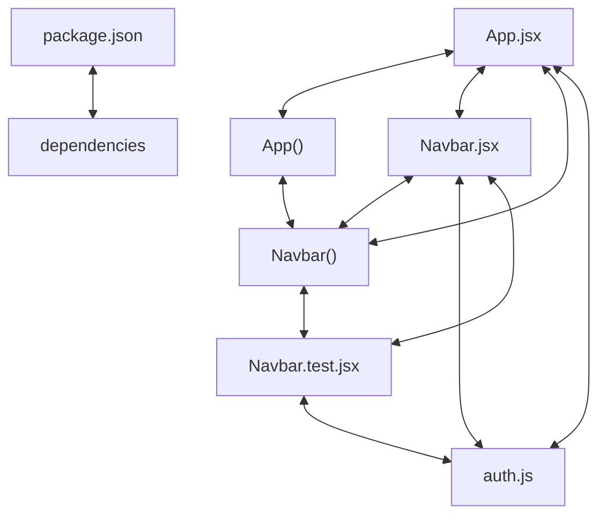

# Codebase Architectural Report

> **Auto-generated** by graphify knowledge graph analysis  
> **Purpose**: Dependency map, connection analysis, subsystem breakdown, and quality hotspots.

---

## 1. Executive Summary

- **Total Components**: `97`
- **Total Connections**: `155`
- **Subsystem Modules**: `1`
- **Dependency Types**: `6`

**Key Architectural Hubs:**

| # | Component | File | Type | Connections |
|---|-----------|------|------|-------------|
| 1 | `package.json` | `package.json` | function | 21 |
| 2 | `App.jsx` | `src/App.jsx` | class | 16 |
| 3 | `Navbar.jsx` | `src/components/Navbar.jsx` | class | 11 |
| 4 | `Navbar.test.jsx` | `src/components/Navbar.test.jsx` | class | 11 |
| 5 | `App()` | `src/App.jsx` | class | 10 |
| 6 | `dependencies` | `package.json` | function | 9 |
| 7 | `auth.js` | `src/utils/auth.js` | file | 9 |
| 8 | `Navbar()` | `src/components/Navbar.jsx` | class | 8 |

---

## 2. Dependency & Connection Analysis

### Relationship Types

| Relationship | Count | Share |
|-------------|-------|-------|
| `contains` | 59 | 38% |
| `imports_from` | 41 | 26% |
| `imports` | 34 | 22% |
| `calls` | 19 | 12% |
| `conceptually_related_to` | 1 | 1% |
| `references` | 1 | 1% |

### Hub Dependency Diagram

### Most Connected Pairs

| Component A | Component B | Shared Connections |
|-------------|-------------|-------------------|
| `@playwright/test` | `foundation.spec.js` | 1 |
| `dependencies` | `package.json` | 1 |
| `devDependencies` | `package.json` | 1 |
| `name` | `package.json` | 1 |
| `package.json` | `private` | 1 |
| `package.json` | `scripts` | 1 |
| `package.json` | `type` | 1 |
| `package.json` | `version` | 1 |
| `autoprefixer` | `package.json` | 1 |
| `jsdom` | `package.json` | 1 |

---

## 3. Subsystem & Module Breakdown

### 3.1 package.json
**Nodes**: `97`  
**Files**: `e2e/foundation.spec.js`, `index.html`, `package.json`, `playwright.config.js`, `postcss.config.js`, `src/App.jsx` +15 more

| Component | Type | File | Connections |
|-----------|------|------|-------------|
| `package.json` | function | `package.json` | 21 |
| `App.jsx` | class | `src/App.jsx` | 16 |
| `Navbar.jsx` | class | `src/components/Navbar.jsx` | 11 |
| `Navbar.test.jsx` | class | `src/components/Navbar.test.jsx` | 11 |
| `App()` | class | `src/App.jsx` | 10 |
| `dependencies` | function | `package.json` | 9 |
| `auth.js` | file | `src/utils/auth.js` | 9 |
| `Navbar()` | class | `src/components/Navbar.jsx` | 8 |
| `ProtectedRoute.test.jsx` | class | `src/components/ProtectedRoute.test.jsx` | 8 |
| `auth.test.js` | file | `src/utils/auth.test.js` | 8 |

---

## 4. API Reference

Public classes and functions by subsystem.

### package.json

| Name | Type | File | Connections |
|------|------|------|-------------|
| `package.json` | function | `package.json` | 21 |
| `App.jsx` | class | `src/App.jsx` | 16 |
| `Navbar.jsx` | class | `src/components/Navbar.jsx` | 11 |
| `Navbar.test.jsx` | class | `src/components/Navbar.test.jsx` | 11 |
| `App()` | class | `src/App.jsx` | 10 |
| `dependencies` | function | `package.json` | 9 |
| `Navbar()` | class | `src/components/Navbar.jsx` | 8 |
| `ProtectedRoute.test.jsx` | class | `src/components/ProtectedRoute.test.jsx` | 8 |

---

## 5. Code Quality & Architectural Risk Hotspots

### Component Type Distribution

| Type | Count | Share |
|------|-------|-------|
| function | 54 | 56% |
| class | 17 | 18% |
| method | 15 | 15% |
| file | 11 | 11% |

### High-Connectivity Hotspots

**2** component(s) with >15 connections:

| Component | File | Connections |
|-----------|------|-------------|
| `package.json` | `package.json` | 21 |
| `App.jsx` | `src/App.jsx` | 16 |

### Dependency Cycles

**63** circular dependency loop(s) detected:

| # | Cycle Path |
|---|-----------|
| 1 | `src_app → src_app_app → src_main` |
| 2 | `src_app → src_utils_auth_getsession → src_app_app` |
| 3 | `src_utils_auth → src_utils_auth_test → src_utils_auth_getsession` |
| 4 | `src_utils_auth → src_utils_auth_setsession → src_utils_auth_test` |
| 5 | `src_utils_auth → src_utils_auth_sessionkey → src_utils_auth_test` |
| 6 | `ref_react_router_dom → src_components_navbar_test → src_utils_auth_sessionkey → src_utils_auth_test → src_utils_auth_getsession → src_app_app → src_main` |
| 7 | `ref_vitest → src_components_navbar_test → src_utils_auth_sessionkey → src_utils_auth_test` |
| 8 | `src_components_navbar_navbar → src_components_navbar_test → src_utils_auth_sessionkey → src_utils_auth_test → src_utils_auth_getsession → src_app_app` |
| 9 | `src_utils_auth → src_components_navbar_test → src_utils_auth_sessionkey` |
| 10 | `src_components_navbar_navbar → src_components_navbar_test_rendernavigation → src_components_navbar_test` |

### Orphaned Components

**2** isolated node(s) with no connections:

| Component | File |
|-----------|------|
| `postcss.config.js` | `postcss.config.js` |
| `tailwind.config.js` | `tailwind.config.js` |

---

## 6. How to Navigate

1. **Interactive D3 Map** — open `graph.html` to explore node connections visually.
2. **Knowledge Graph Queries** — use MCP tools (`graph_query`, `graph_explain_node`, `graph_impact_radius`).
